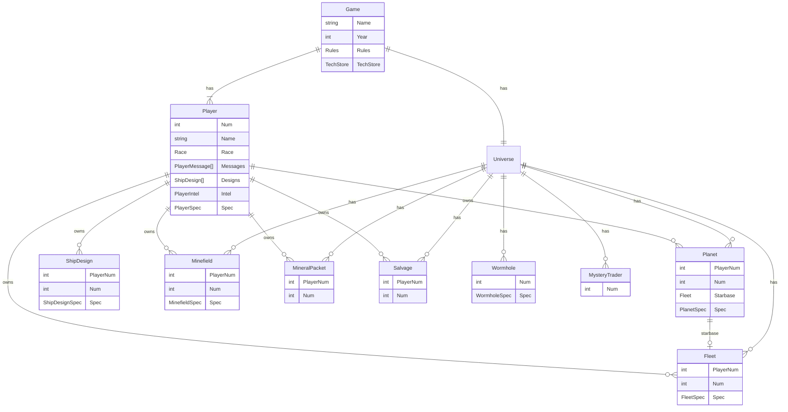
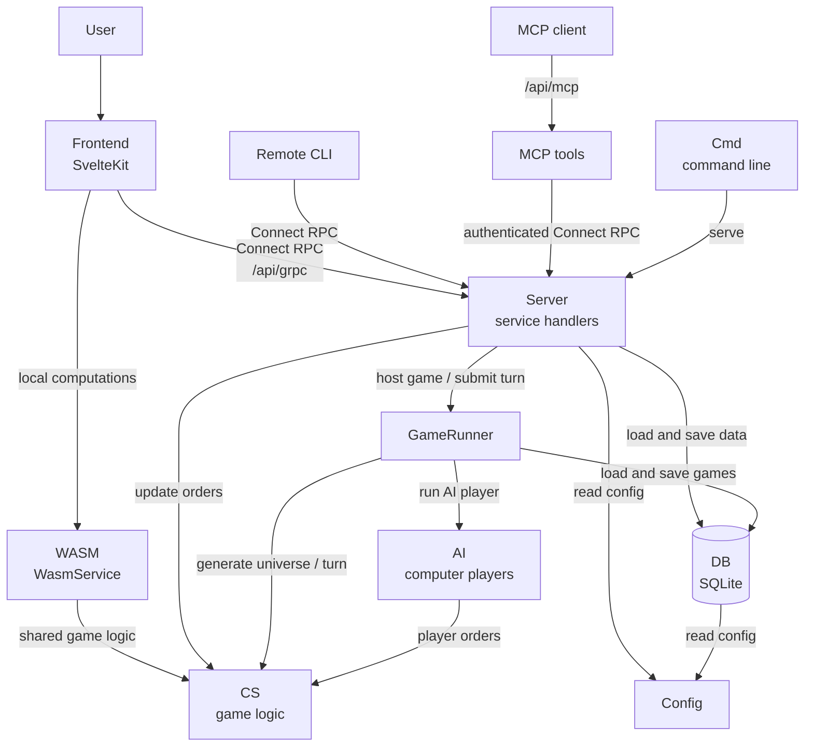
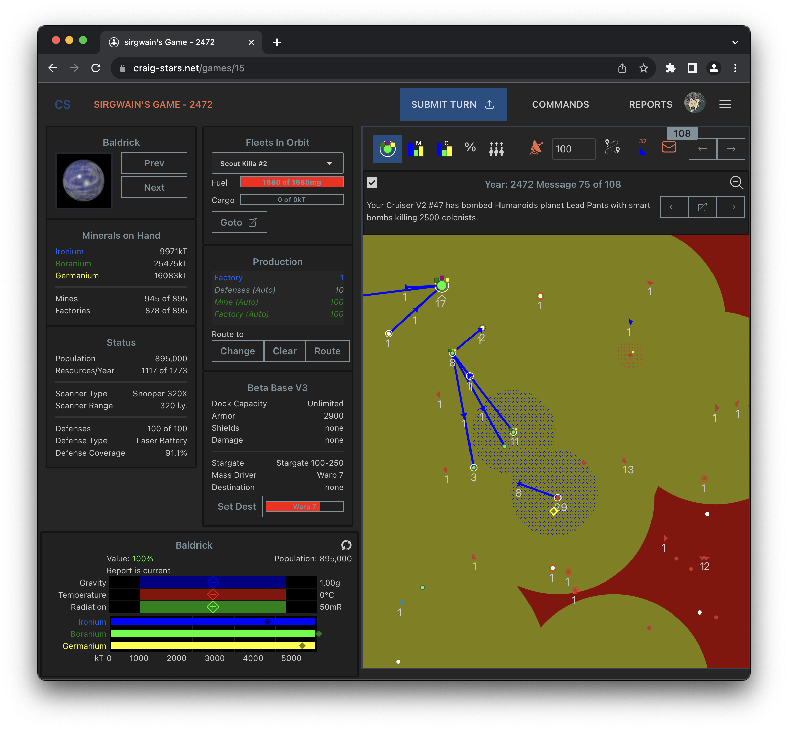

# Architecture

`craig-stars` is a monorepo containing code for both the frontend client and the backend server.

## Tech Stack

`craig-stars` is built on top of the following excellent technologies:

- [golang](https://go.dev)
- [svelte](https://svelte.dev) 5 + [sveltekit](https://kit.svelte.dev) (with static adapter)
- [sqlc](https://sqlc.dev) + [sqlite](https://www.sqlite.org)
- [protobuf](https://protobuf.dev) + [buf](https://buf.build)
- [Connect](https://connectrpc.com) (for typed RPC clients and handlers)
- [TinyGo](https://tinygo.org) (for release WebAssembly builds)
- [golang-migrate](https://github.com/golang-migrate/migrate)
- [goverter](https://github.com/jmattheis/goverter)
- [go-chi](https://github.com/go-chi/chi)
- [disgo](https://github.com/disgoorg/disgo)
- [go-pkgz/auth](https://github.com/go-pkgz/auth)
- [cobra](https://github.com/spf13/cobra) (for cli)
- [viper](https://github.com/spf13/viper) (for config)
- [tailwindcss](https://tailwindcss.com)
- [daisyui](https://daisyui.com)

Icons are either hand crafted, taken from the original Stars! files or from the wonderful [game-icons.net](https://game-icons.net) and [heroicons.com](https://heroicons.com).

## File Structure

This is a brief overview of the most critical folders inside the `craig-stars` repo, sorted in roughly decreasing order of precedence.

| path          | description                                                                                                                                                                                                                                               |
| ------------- | --------------------------------------------------------------------------------------------------------------------------------------------------------------------------------------------------------------------------------------------------------- |
| `/`           | The root folder contains the `main.go` entrypoint into the application, as well as various backend config and formatting files.                                                                                                                           |
| `/cs`         | The `cs` package houses all internal game logic and data types, comprising the majority of the backend code. It serves as the backbone upon which all the other packages rely on. More details in the [cs](#cs) section.                                  |
| `/db`         | The `db` package handles serializing games to and from the database, as well as any UI database queries. More details in the [db](#db) section.                                                                                                           |
| `/server`     | The `server` package is where the webserver routes are configured. It is the "glue" that ties the `cs` and `db` packages together. More details in the [server](#server) section.                                                                         |
| `/cmd`        | The `cmd` package handles command line parsing for the `main.go` executable. It functions as the entrypoint for serving the application, generating files, etc etc.                                                                                       |
| `/cmd/update` | The `update` package handles updating a game's host or player.                                                                                                                                                                                            |
| `/config`     | The `config` package houses database & server configuration code. Configuration is shared by the database and the server. The config defaults to settings for local development.                                                                          |
| `/proto`      | Contains protobuf message and service definitions, generated Go code, and converters between protobuf messages and `cs` models. More details in the [proto](#proto) section.                                                                              |
| `/proto-wasm` | Contains the protobuf transport support used by the WASM bridge.                                                                                                                                                                                          |
| `/generators` | Contains custom generators for enum conversions and WASM service handlers.                                                                                                                                                                                |
| `/wasm`       | The `wasm` package contains all the logic needed to call backend functions from within the frontend via [WebAssembly](https://en.wikipedia.org/wiki/WebAssembly).                                                                                         |
| `/ai`         | The `ai` package contains logic governing AI player (computer opponent) behavior. The AI strives to be "just another player" with no special insight or privileges compared to a human player.                                                            |
| `/test`       | The `test` package contains common testing utilities used throughout the other backend packages. A notable contender is [`CompareAsJSON`](../test/test.go), which serializes & compares 2 JSON objects before piping the diff to both stdout and `./tmp`. |
| `/frontend`   | The `frontend` folder contains all the SvelteKit\TypeScript frontend code (as well as formatting files for said frontend code). More details in the [frontend](#frontend) section.                                                                        |

Other miscellaneous folders that may or may not be on the remote:

| path                 | description                                                                                                                                                                                                                                                                                         | On Remote? |
| -------------------- | --------------------------------------------------------------------------------------------------------------------------------------------------------------------------------------------------------------------------------------------------------------------------------------------------- | ---------- |
| `/.github/workflows` | Contains the Github Actions workflows for CI integration.                                                                                                                                                                                                                                           | ✅         |
| `/.vscode`           | Contains VS Code build tasks, debugger configurations and other assorted settings for both `root` and `frontend` separately.                                                                                                                                                                        | ✅         |
| `/data`              | Contains the SQLite database used by the `db` and `server` packages.                                                                                                                                                                                                                                | ❌         |
| `/dist`              | Contains the built `craig-stars` executable (`craig-stars.exe` on windows) during local development.                                                                                                                                                                                                | ❌         |
| `/magefiles`         | Contains all the build code used by [mage](https://magefile.org) for running tasks. [`launch.go`](../magefiles/launch.go) contains all the code to build & launch the server, while [`utils.go`](../magefiles/utils.go) contains functions for testing, linting and other miscellaneous operations. | ✅         |

The repository uses a [Go workspace](../go.work). Packages such as `cs`, `wasm`, `test`, and the custom generators have their own modules so the game logic can be shared between the server and browser builds.

## cs

The [cs](../cs) package contains the models and game logic. It contains no serialization logic. There are two main interfaces into the game logic. The [Gamer](../cs/gamer.go) and the [Orderer](../cs/orderer.go). The `Gamer` is used to create games, generate universes and generate new turns. The `Orderer` is used to update player `Research`, `Planet`, `Fleet`, and `Minefield` orders, as well as to handle in turn cargo transfers. The `server` makes uses of these interfaces to update game data and save changes back to the database.

### Game Makeup

Every entity in a `craig-stars` game has an integer `Num` associated with it. `Num`s start at 1. Planet #1, Fleet #1, Salvage #1, etc. A value of 0 is considered `None`. Entities that are owned by players also have a `PlayerNum`. If the owner is optional (in the case of a Planet), the `PlayerNum` will be 0.

### Specs

`craig-stars` has a lot of computed values. Planets compute their habitability and growth rate, ship designs compute their power rating and component bonuses, fleets compute their cargo/fuel capacity, etc. All computed values are stored in an object's `Spec` field, and are computed by the various `compute*Spec` functions. Specs are computed at the start and end of turns (and sometimes during turns where needed). When players update orders, specs are also recomputed. Spec calculations relying on preset constants reference the Game's `Rules` struct to access said constants.

One such dynamically computed `Spec` value is the maximum usable factories for a given planet, dependent on its population/max population and the race's preset "factories operated" value.

### Entity Diagram



## db

`craig-stars` uses a sqlite database. sqlite is super performant and easy to manage. It can also be run in memory mode making unit testing a snap.

Because sqlite is file based, in the future it may be updated to use a separate file per game, but for now a single db is working great.

The schema for the database is embedded with `go:embed`. When the server starts up, it checks for new sql schema files and [migrates](../db/migrate.go) the database. New migrations are added as files in the [schema/filesystem](../db/schema/filesystem) folder. The [schema/memory](../db/schema/memory) folder holds a single schema file with the complete, current schema, so every migration must also be applied to it by hand. That file is used for in memory databases during unit tests, and it is the schema sqlc generates its query code from.

There is also an [upgrade.go](../db/upgrade.go) that handles game logic updates, for example adding AR planet internal scanners, or adding artifacts. Any changes that require data changes to existing games can be made as an upgrade step here.

### queries and conversions

SQL queries live in [db/queries](../db/queries). [sqlc.yaml](../sqlc.yaml) describes how sqlc generates typed query methods and database models in [db/generated](../db/generated). The `db` package wraps these methods with game-specific loading, saving, and transaction logic.

Database models are converted to and from `cs` models using [Goverter](https://github.com/jmattheis/goverter). The conversion interface and custom conversions are defined in [db/converter.go](../db/converter.go); Goverter produces `converter.generated.go`. Edit the interface or custom conversions when changing a mapping, then regenerate the output.

### json in the database

Rather than create a unique column for every single value stored by `craig-stars`, many things are serialized as json blocks and put into the database as text. This makes it easier to update the schema. For objects that don't need to be independently queried from the DB, a json schema is generally used. Some examples of this are a Player's Race and the Specs that are still saved, like a Planet's. Other Specs, like a Player's, aren't saved at all and are computed when the game is loaded.

## proto

The [proto](../proto) folder defines the messages and services shared by the server and frontend. Message definitions describe data such as planets, fleets, and players, while service definitions describe operations such as updating orders or submitting a turn.

[Buf](https://buf.build) generates Go messages, Connect handlers, MCP tools, and WASM handlers using [buf.gen.yaml](../buf.gen.yaml). The frontend has its own [buf.gen.yaml](../frontend/buf.gen.yaml) which generates TypeScript messages and service definitions into `frontend/src/lib/protogen`.

The game logic continues to use `cs` models. [proto/converter](../proto/converter) uses Goverter to convert between these models and protobuf messages. Custom enum conversions are generated from [enums.yaml](../enums.yaml). TypeScript types are generated from the protobuf definitions.

### generated code

Run the following command from the repository root after changing schemas or conversion interfaces:

```bash
mage generate
```

This runs sqlc, Buf, Go generators (including Goverter), and frontend protobuf generation. It also exports the current tech store and default rules as JSON for the frontend. Generated files should be updated through their source definitions rather than edited directly. The generation steps are defined in [magefiles/launch.go](../magefiles/launch.go).

## server

The [server](../server) package contains the backend [server](../server/server.go) and the [GameRunner](../server/gamerunner.go). Most frontend requests use Connect RPC services under `/api/grpc`. Handlers for various resources are defined in their own files ([fleetservice.go](../server/fleetservice.go), [planetservice.go](../server/planetservice.go), etc). Two REST routes remain under `/api/games/{id}`: `compute-specs` and `ping-discord`.

The service handlers convert protobuf requests into `cs` models, call game logic, persist changes through `db`, and convert results back into protobuf responses. Interceptors provide database access, game context, and error logging. Authentication and authorization determine which user and player can access a game or change its orders.

The [GameRunner](../server/gamerunner.go) hooks up the [Gamer](../cs/gamer.go) with the database. The `GameRunner` hosts new games, updates game players, and generates new turns when players submit their turns. It also loads a player's game information from the database and runs AI players during turn generation.

### MCP and command line access

The server also exposes [MCP](https://modelcontextprotocol.io) tools at `/api/mcp`. Tools generated from the protobuf services call the same Connect services, forwarding the caller's credentials. API tokens and OAuth support authenticated access. The remote commands in [cmd](../cmd) also use Connect clients to access games and races.



## wasm

The [wasm](../wasm) module compiles shared Go game logic into WebAssembly so the frontend can perform calculations without a server request. Examples include race points, habitability, ship design specs, production estimates, and waypoint calculations. The server still saves orders and generates turns.

[wasm.proto](../proto/craig_stars/v1/wasm.proto) defines `WasmService`. The custom generator in [generators/protoc-gen-wasm-go](../generators/protoc-gen-wasm-go) generates the handlers that connect protobuf requests to the [WASM service implementation](../wasm/wasm/wasmservice.go).

The frontend [loads the module](../frontend/src/lib/wasm.ts) using `wasm_exec.js` and creates a Connect client with a custom transport. Requests and responses are encoded as protobuf bytes and passed through the Go/JavaScript bridge instead of sent over HTTP. The module keeps player, design, and intel data needed for its calculations.

`mage build_wasm` builds `frontend/src/lib/wasm/cs.wasm` using Go and copies the matching Go runtime script. `mage build_wasm_tinygo` builds it using TinyGo and copies the TinyGo runtime script. Local backend builds use Go, while CI backend builds use TinyGo. Rebuild the module after changing shared game logic or WASM services.

## frontend

The [frontend](../frontend) is a static SvelteKit site that loads game information from the backend Connect RPC services under `/api/grpc` and displays it to the user. The `frontend` also handles updating changes to player research, planet, fleet, and minefield orders by calling the corresponding RPC services.

### Game View

The main [game view](<../frontend/src/routes/(user)/games/(game)/[id]/(main)/Game.svelte>) is split into sections.



| section      | description                                                           |
| ------------ | --------------------------------------------------------------------- |
| Scanner      | The zoomable and pannable map display of the universe.                |
| Command Pane | Tiles with information about the currently commanded planet or fleet. |
| Summary Pane | A small summary about the currently selected map object.              |

### frontend structure

| path     | description                                                                                                                                                                                                                                                                                 |
| -------- | ------------------------------------------------------------------------------------------------------------------------------------------------------------------------------------------------------------------------------------------------------------------------------------------- |
| `css`    | Contains tailwind `@apply` overrides and the various icon classes for techs and planets.                                                                                                                                                                                                    |
| `lib`    | `lib` contains type definitions for server side models, typed clients for interacting with the backend RPC services, and any reusable components (components that exist outside of a single page).                                                                                          |
| `routes` | `routes` contains all the user accessible routes for the application. Almost all routes require the user to be logged in and are in the `(user)` route group. The main game view is located under [src/routes/(user)/games/(game)/[id]](<../frontend/src/routes/(user)/games/(game)/[id]>). |

### Svelte 5

Components use Svelte 5 runes such as `$state` for local reactive state, `$derived` for computed values, `$effect` for reacting to changes, and `$props` for component inputs. Shared game state still uses Svelte stores and contexts; runes and stores are both part of the frontend.

### stores

Webapps are all about reactivity. When the user makes a change or some new data is loaded from the server, the front end needs to react to this new data and update a portion of the page. Svelte components use the `$` prefix to subscribe to [stores](https://svelte.dev/docs/svelte/stores). `craig-stars` makes use of stores, along with [contexts](https://svelte.dev/docs/svelte#setcontext) to ensure the components update when their data change. For example, if cargo is transferred from a planet to a fleet, the planet minerals tile needs to update.

Every component under the game route (`/games/[id]`) has access to a context:

```ts
type GameContext = {
	game: Readable<FullGame>;
	player: Readable<CommandedPlayer>;
	universe: Readable<Universe>;
	settings: Writable<PlayerSettings>;
	messageNum: Writable<number>;
	// ... and more
};

// accessed like this
const { game, player, universe, settings } = getGameContext();
```

This context contains reactive stores with the state of the game, for example a component like this would automatically update the game year when it was updated by the server.

```html
<script lang="ts">
	import { getGameContext } from "#lib/services/GameContext.js";

	const { game, player, universe } = getGameContext();
</script>

<h1>{$game.year}</h1>
```

`craig-stars` frontend code makes great use of contexts and stores to update the UI and keep components small.

The `GameContext` is used to react to state changes (`$game.year` updates each time a turn is generated). It also contains methods to update the state, such as `commandMapObject()` or `updatePlayerOrders()`.

Planets and Fleets owned by the player can be Commanded, at which point they show up in the Command Pane. All map objects can be Selected, at which point they show up in the Selection Summary.

A single click selects a map object. A second click commands the map object if it is owned by the player. Commanded map objects can have their orders changed by the player.

- `CommandedPlanet` - The currently commanded planet, or undefined if no planet is commanded.
- `CommandedFleet` - The currently commanded fleet, or undefined if no fleet is commanded.
- `SelectedMapObject` - The currently selected map object, or undefined if no map object is selected.

## test games

Test games provide predefined scenarios for manual testing and automated tests. Scenario definitions live in the [cs](../cs) package and are registered in [test/testgames/testgames.go](../test/testgames/testgames.go). `cs.BuildScenario` builds a full game from a scenario, including its players, planets, fleets, and designs.

The [TestService](../server/testservice.go) lists available scenario names and creates a saved game from a selected scenario. Playwright's [setup helpers](../frontend/e2e/setup.ts) create games through authenticated requests to this service. The `testGamePage` fixture tracks the games it creates and deletes them during cleanup, so tests can start with a fresh scenario.

To add a test game, define a scenario in `cs`, register it in `TestGames`, and use its name in a test. Components that need to be viewed outside a game can have a test page under [frontend/src/routes/(user)/tests](<../frontend/src/routes/(user)/tests>). See [Local Development](development.md#testing) for commands to run Go, Vitest, and Playwright tests.

## making changes

A change can involve several representations of the same data. For example, adding a saved planet field may require changes in each of these places:

| path                         | change                                                                                                          |
| ---------------------------- | --------------------------------------------------------------------------------------------------------------- |
| `cs`                         | Add the field and any game logic or spec calculations.                                                          |
| `db/schema` and `db/queries` | Update storage and queries if the field needs a database column. JSON-backed data may not need a schema change. |
| `db/converter.go`            | Update conversions between database and game models as needed.                                                  |
| `proto/craig_stars/v1`       | Add the field to the protobuf message or service request.                                                       |
| `proto/converter`            | Update conversions between protobuf and game models as needed.                                                  |
| `server`                     | Update service behavior and persistence.                                                                        |
| `wasm`                       | Update browser calculations if they use the field.                                                              |
| `frontend`                   | Display the field or include it in orders, using the generated types.                                           |

Run `mage generate` to update generated code, rebuild WASM if its inputs changed, and run the tests relevant to the change. Database migrations change storage, while [db/upgrade.go](../db/upgrade.go) handles game data upgrades when existing games need new values.
